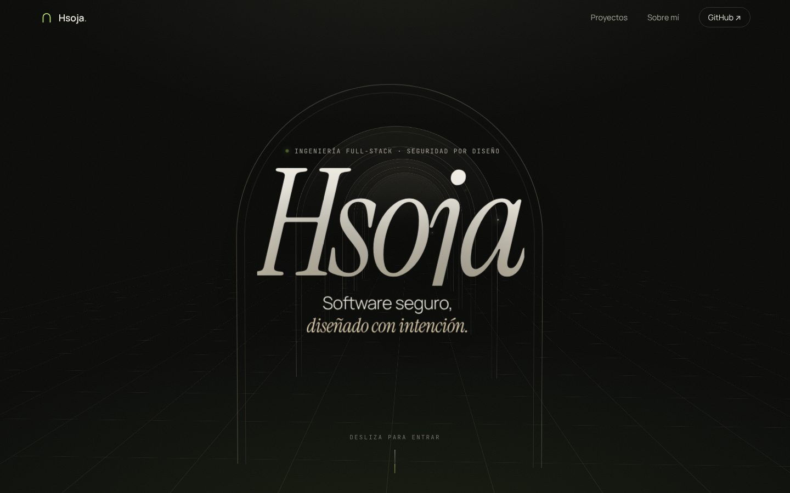

# Hsoja · Portfolio

**A single-page personal portfolio with scroll-driven 3D storytelling, built with plain HTML, CSS and JavaScript.**

The page walks the visitor through a corridor of Mediterranean arches as they scroll, then presents three featured projects as layered 3D previews that respond to scroll and pointer. No frameworks, no build step, no third-party scripts and no network requests at runtime.

🔗 **Live site:** https://hsoja.github.io/Portfolio/



## Features

- 🏛️ **3D scroll storytelling**: a CSS 3D scene (`perspective` + `preserve-3d`) where the camera moves through arches as you scroll, with depth fog and subtle pointer parallax.
- 🧊 **Layered project previews**: each card has three planes at different depths that tilt with scroll and pointer and separate on hover.
- ✨ **Scroll reveals** with `IntersectionObserver` (fade + translate + scale) and magnetic buttons.
- ⚡ **Fast by design**: only `transform` and `opacity` are animated, and a single `requestAnimationFrame` loop runs only while something is moving.
- 📱 **Responsive and accessible**: from 360 px phones to wide screens, skip link, visible focus, semantic landmarks, and a static version when `prefers-reduced-motion` is on.
- 🔐 **Secure static site**: see [Security](#security).

## Featured projects

| Project | What it is |
| --- | --- |
| [Operativa.ia](https://github.com/Hsoja/Operativa.ia) | 24/7 AI customer service and scheduling for small service businesses (FastAPI, React, LLM). |
| [Gloz](https://github.com/Hsoja/Gloz) | Secure property listings web app (Flask, SQLite, Argon2id). |
| [TradePro](https://github.com/Hsoja/TradePro) | Real-time market news portal (Astro, TypeScript). |

## Tech stack

| Layer | Technologies |
| --- | --- |
| Page | Semantic HTML, hand-written CSS (3D transforms, custom properties), vanilla JavaScript |
| Fonts | Self-hosted Instrument Serif, Manrope and JetBrains Mono (SIL OFL) |
| Local server | Python standard library (`http.server`), allow-listed routes |
| Testing & QA | Node's built-in test runner, pytest, Bandit, gitleaks, Semgrep |
| CI/CD | GitHub Actions with pinned action SHAs and read-only permissions, Dependabot, GitHub Pages |

## Project structure

```
├── index.html               The page (strict CSP in a <meta> tag)
├── serve.py                 Hardened local static server (not deployed)
├── styles.css               Design tokens, 3D scene and all styles
├── main.js                  Scroll camera, tilt, reveals, magnetic buttons
├── fonts/                   Self-hosted woff2 fonts
├── _headers                 Security headers for hosts that support them (Netlify, Cloudflare Pages)
├── robots.txt
├── tests/                   Security regression tests (node --test)
├── scripts/                 build.sh (copies public files to _site/), scan_exposed_files.sh
├── docs/                    Screenshot
├── .github/                 CI security pipeline, Pages deployment, Dependabot
└── SECURITY_REPORT.md       Latest audit results
```

## Run it locally

No dependencies are needed. Use the hardened local server (security headers, allow-listed files only, GET/HEAD only, bound to `127.0.0.1`):

```bash
git clone https://github.com/Hsoja/Portfolio.git
cd Portfolio
python3 serve.py                # then open http://127.0.0.1:8000
```

`python3 -m http.server` also works, but it sends no security headers and lists directories.

| Command | What it does |
| --- | --- |
| `npm test` | Run the front-end security regression tests |
| `python3 -m pytest -q` | Run the local server and front-end tests (needs `pytest`) |
| `npm run build` | Copy only the public files to `_site/` |
| `npm run verify` | Tests, build and the exposed-files check |

## Security

- **Strict Content Security Policy**: `default-src 'none'`, scripts and styles only from the same origin, `connect-src 'none'` (the page makes no network requests), no `unsafe-inline` or `unsafe-eval`.
- **No third-party code**: no CDNs, analytics, cookies or storage. Fonts are self-hosted.
- **No dangerous sinks**: no `eval`, `innerHTML` or `document.write`; dynamic values are set through the CSSOM.
- **Safe links**: every external link uses `rel="noopener noreferrer"` and points to an allow-listed host.
- **Clickjacking**: GitHub Pages cannot send `frame-ancestors`, so the page hides itself when loaded inside a foreign iframe. `_headers` sends the full header set on hosts that support it.
- **Regression tests** enforce all of the above on every push, alongside gitleaks (full history) and Semgrep in CI.
- Only the public files are deployed (to the `gh-pages` branch, after the tests pass); tests, scripts, docs and `serve.py` never reach the live site.

Details and results are in [SECURITY_REPORT.md](SECURITY_REPORT.md).

## License

[MIT](LICENSE). Fonts are licensed under the SIL Open Font License 1.1.

## Author

Built by [Hsoja](https://github.com/Hsoja).
